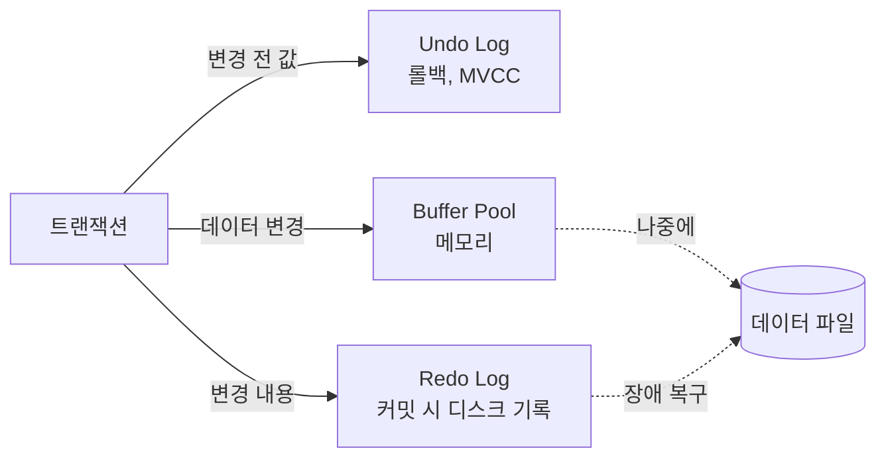

# ACID

## 트랜잭션

트랜잭션은 **더 이상 쪼갤 수 없는 작업 단위**다. 안에 든 작업이 모두 성공하거나 모두 실패해야 한다.

```sql
START TRANSACTION;
UPDATE account SET balance = balance - 10000 WHERE id = 1;   -- A 출금
UPDATE account SET balance = balance + 10000 WHERE id = 2;   -- B 입금
COMMIT;
```

출금만 되고 입금이 안 되면 돈이 사라진다. 그래서 두 UPDATE를 하나의 트랜잭션으로 묶는다.

트랜잭션이 지켜야 하는 성질 네 가지를 ACID라고 한다.

## Atomicity (원자성)

**전부 반영되거나 하나도 반영되지 않는다.**

- 중간에 실패하면 이미 실행한 작업도 되돌린다. (롤백)
- DB는 **Undo Log**에 변경 전 값을 기록해둔다. 롤백할 때 이 값으로 되돌린다.

## Consistency (일관성)

**트랜잭션 전후로 DB가 정해진 규칙을 지키는 상태여야 한다.**

- PK, FK, UNIQUE, NOT NULL, CHECK 같은 제약 조건을 어기는 트랜잭션은 실패한다.
- "잔액은 음수가 될 수 없다", "출금액과 입금액의 합은 0" 같은 비즈니스 규칙은 DB가 다 알 수 없다. 애플리케이션이 같이 책임진다.
- 나머지 세 성질(A, I, D)은 DB가 보장하는 기능이고, 일관성은 그걸 이용해서 애플리케이션이 지키는 목표에 가깝다.

## Isolation (격리성)

**동시에 실행되는 트랜잭션이 서로 영향을 주지 않아야 한다.**

- 완벽하게 지키려면 트랜잭션을 하나씩 순서대로 실행해야 한다. 그러면 동시 처리 성능이 크게 떨어진다.
- 그래서 DB는 **격리 수준(Isolation Level)**을 여러 단계로 나눠서 성능과 정합성 사이에서 고르게 한다. ([Isolation Level](./isolation-level.md))
- 구현은 락과 MVCC로 한다.

## Durability (지속성)

**커밋된 결과는 장애가 나도 사라지지 않는다.**

- 커밋할 때마다 데이터 파일 전체를 디스크에 쓰면 느리다. 데이터 페이지는 메모리(Buffer Pool)에서만 바꾸고 나중에 디스크에 쓴다.
- 대신 변경 내용을 **Redo Log**(WAL, Write-Ahead Log)에 순서대로 먼저 기록한다. 로그는 끝에 덧붙이기만 해서 빠르다.
- 커밋 전에 Redo Log를 디스크에 `fsync`한다. 서버가 죽으면 재시작할 때 Redo Log를 다시 적용해서 커밋된 내용을 복구한다.
- MySQL은 `innodb_flush_log_at_trx_commit=1`(기본값)일 때 커밋마다 로그를 디스크에 내린다. 0이나 2로 바꾸면 빨라지지만 장애 시 최근 커밋이 사라질 수 있다.



## Spring에서 트랜잭션

```java
@Transactional
public void transfer(Long fromId, Long toId, long amount) {
    Account from = accountRepository.findById(fromId).orElseThrow();
    Account to = accountRepository.findById(toId).orElseThrow();
    from.withdraw(amount);
    to.deposit(amount);
}
```

- `@Transactional`은 9주차에서 본 프록시로 동작한다. 메서드 시작 전에 트랜잭션을 열고 끝나면 커밋한다.
- 같은 트랜잭션은 **같은 DB 커넥션**을 써야 한다. `TransactionSynchronizationManager`가 커넥션을 스레드(ThreadLocal)에 묶어둔다.
- 롤백 규칙
  - `RuntimeException`과 `Error`가 나면 롤백한다.
  - 체크 예외(`Exception`)는 기본으로 **커밋한다.** 비즈니스 예외로 보기 때문이다.
  - `@Transactional(rollbackFor = Exception.class)`로 바꿀 수 있다.
