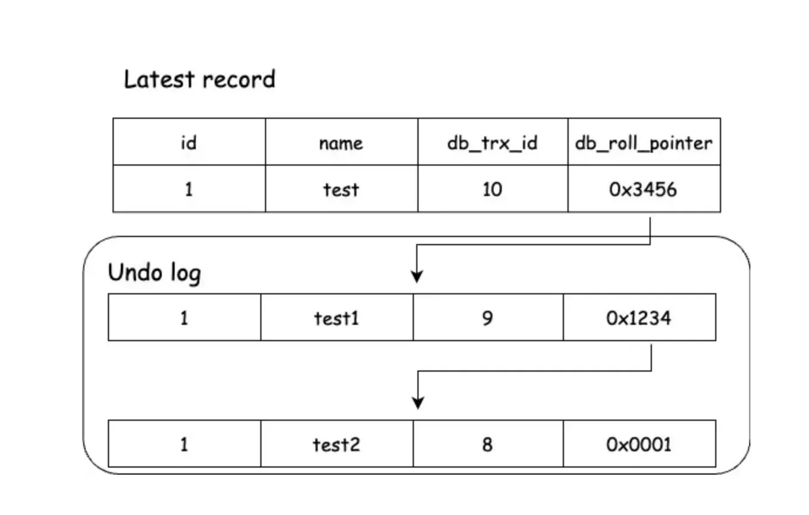
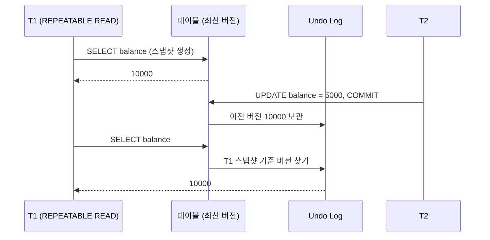

# Isolation Level

## 동시성 이상 현상

격리 수준을 낮추면 다음 문제가 생길 수 있다.

### Dirty Read

**커밋되지 않은 데이터를 다른 트랜잭션이 읽는다.**

```text
T1: UPDATE item SET stock = 0 WHERE id = 1;
T2: SELECT stock FROM item WHERE id = 1;   -- 0을 읽음
T1: ROLLBACK;                              -- 실제로는 stock이 0이 된 적이 없음
```

### Non-Repeatable Read

**같은 행을 두 번 읽었는데 값이 다르다.**

```text
T1: SELECT balance FROM account WHERE id = 1;   -- 10000
T2: UPDATE account SET balance = 5000 WHERE id = 1; COMMIT;
T1: SELECT balance FROM account WHERE id = 1;   -- 5000
```

### Phantom Read

**같은 조건으로 두 번 조회했는데 없던 행이 생기거나 있던 행이 사라진다.**

```text
T1: SELECT COUNT(*) FROM orders WHERE member_id = 1;   -- 3
T2: INSERT INTO orders (member_id) VALUES (1); COMMIT;
T1: SELECT COUNT(*) FROM orders WHERE member_id = 1;   -- 4
```

Non-Repeatable Read는 기존 행의 값이 바뀌는 문제고, Phantom Read는 행이 추가되거나 삭제되는 문제다.

### 표준 밖의 이상 현상

- **Lost Update**: 두 트랜잭션이 같은 값을 읽고 각자 수정하면 나중에 커밋한 쪽이 앞의 수정을 덮어쓴다.
- **Write Skew**: 두 트랜잭션이 서로 다른 행을 수정하는데, 둘 다 같은 조건을 읽고 판단해서 합쳐보면 규칙이 깨진다. (당직 의사가 최소 1명이어야 하는데 두 명이 동시에 빠지는 경우)

이 둘은 SQL 표준 격리 수준 정의에 없다. REPEATABLE READ에서도 생길 수 있어서 따로 막아야 한다. ([낙관적 / 비관적 Lock](./optimistic-pessimistic-lock.md))

## 격리 수준 4단계

| 격리 수준 | Dirty Read | Non-Repeatable Read | Phantom Read |
| --- | --- | --- | --- |
| READ UNCOMMITTED | 발생 | 발생 | 발생 |
| READ COMMITTED | X | 발생 | 발생 |
| REPEATABLE READ | X | X | 발생 (표준 기준) |
| SERIALIZABLE | X | X | X |

아래로 갈수록 정합성은 높아지고 동시 처리 성능은 떨어진다.

### READ UNCOMMITTED

커밋하지 않은 변경도 다른 트랜잭션이 본다. 정합성 문제가 커서 거의 쓰지 않는다.

### READ COMMITTED

커밋된 데이터만 읽는다. **Oracle, PostgreSQL, SQL Server의 기본값**이다.

- 쿼리를 실행할 때마다 그 시점에 커밋된 최신 값을 읽는다.
- 그래서 한 트랜잭션 안에서도 같은 SELECT 결과가 달라질 수 있다.

### REPEATABLE READ

트랜잭션 안에서 같은 행을 다시 읽으면 처음과 같은 값이 나온다. **MySQL InnoDB의 기본값**이다.

### SERIALIZABLE

트랜잭션을 순서대로 실행한 것과 같은 결과를 보장한다.

- MySQL InnoDB는 일반 SELECT도 `FOR SHARE`처럼 공유 락을 건다. (autocommit이 꺼져 있을 때) 그래서 동시성이 크게 떨어진다.
- PostgreSQL은 락 대신 SSI(Serializable Snapshot Isolation)로 충돌을 감지하고, 충돌하면 한쪽을 실패시킨다. 실패한 트랜잭션은 애플리케이션이 재시도해야 한다.

## MVCC (Multi-Version Concurrency Control)

락만으로 격리를 구현하면 읽기와 쓰기가 서로 막는다. 그래서 대부분의 DB는 **MVCC**를 쓴다.

- 행을 수정할 때 이전 버전을 Undo Log에 남긴다.
- 읽는 트랜잭션은 락 없이 **자기가 볼 수 있는 버전**을 Undo Log에서 찾아 읽는다.
- 그래서 **읽기는 쓰기를 막지 않고, 쓰기도 읽기를 막지 않는다.**



> 출처: [MVCC(Multi Version Concurrency Control)와 Read View 알아보기 (velog @young_gyu)](https://velog.io/@young_gyu/MVCCMulti-Version-Concurrency-Control에-관하여)

각 행에는 마지막으로 수정한 트랜잭션 ID(`DB_TRX_ID`)와 이전 버전을 가리키는 포인터(`DB_ROLL_PTR`)가 숨어 있다. 읽는 트랜잭션은 이 포인터를 따라가면서 자기가 볼 수 있는 버전을 찾는다.



READ COMMITTED와 REPEATABLE READ의 차이는 **스냅샷(Read View)을 언제 만드냐**다.

| | 스냅샷 생성 시점 |
| --- | --- |
| READ COMMITTED | SELECT를 실행할 때마다 |
| REPEATABLE READ | 트랜잭션에서 첫 SELECT를 실행할 때 한 번 |

## MySQL REPEATABLE READ와 Phantom Read

표준에서는 REPEATABLE READ에서 Phantom Read가 생길 수 있다. MySQL InnoDB에서는 대부분 생기지 않는다.

- **일반 SELECT(consistent read)**: 트랜잭션 시작 시점 스냅샷을 읽는다. 나중에 들어온 행은 보이지 않는다.
- **잠금 SELECT(`FOR UPDATE`, `FOR SHARE`)와 UPDATE, DELETE**: 스냅샷이 아니라 최신 데이터를 읽는다. 대신 **Next-Key Lock**으로 행 사이의 빈 공간까지 잠가서 다른 트랜잭션이 그 범위에 INSERT하지 못하게 막는다.

다만 둘을 섞으면 예외가 있다.

```text
T1: SELECT * FROM orders WHERE member_id = 1;              -- 3건 (스냅샷)
T2: INSERT INTO orders (member_id) VALUES (1); COMMIT;
T1: SELECT * FROM orders WHERE member_id = 1 FOR UPDATE;   -- 4건 (최신 데이터)
```

## Lost Update와 DB별 차이

```text
T1: SELECT stock FROM item WHERE id = 1;           -- 10
T2: SELECT stock FROM item WHERE id = 1;           -- 10
T1: UPDATE item SET stock = 9 WHERE id = 1; COMMIT;
T2: UPDATE item SET stock = 9 WHERE id = 1; COMMIT;  -- 2개 팔렸는데 재고는 9
```

- **MySQL REPEATABLE READ**: UPDATE는 최신 값을 기준으로 실행되고 충돌을 감지하지 않는다. Lost Update가 그대로 생긴다.
- **PostgreSQL REPEATABLE READ**: T1이 먼저 커밋한 행을 T2가 수정하려고 하면 `could not serialize access due to concurrent update` 에러로 T2를 실패시킨다.

애플리케이션에서 읽고 계산해서 쓰는 코드라면 격리 수준만 믿지 말고 락이나 원자적 UPDATE(`SET stock = stock - 1`)를 같이 쓴다.

## Spring에서 격리 수준 지정

```java
@Transactional(isolation = Isolation.READ_COMMITTED)
public void method() { ... }
```

기본값 `Isolation.DEFAULT`는 DB의 기본 격리 수준을 따른다.
