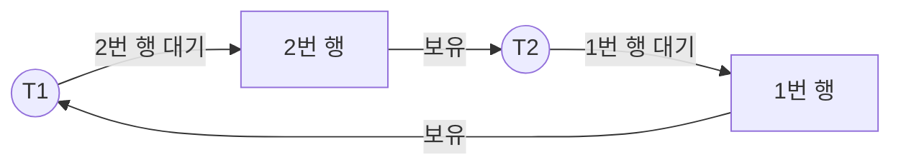

# Lock / Deadlock

## Lock

락은 **여러 트랜잭션이 같은 데이터를 동시에 바꾸지 못하게 순서를 정하는 장치**다. MVCC가 읽기와 쓰기의 충돌을 줄여준다면, 쓰기와 쓰기의 충돌은 락이 막는다.

### 공유 락과 배타 락

| | 공유 락 (S, Shared) | 배타 락 (X, Exclusive) |
| --- | --- | --- |
| 용도 | 읽기 | 쓰기 |
| SQL | `SELECT ... FOR SHARE` | `SELECT ... FOR UPDATE`, UPDATE, DELETE, INSERT |
| 다른 S 락 | 같이 걸 수 있음 | 대기 |
| 다른 X 락 | 대기 | 대기 |

- 공유 락끼리는 함께 걸린다. 여러 트랜잭션이 같이 읽을 수 있다.
- 배타 락은 혼자만 걸린다. 다른 트랜잭션은 락이 풀릴 때까지 기다린다.
- 락은 보통 **트랜잭션이 끝날 때(커밋, 롤백) 풀린다.**
- MVCC를 쓰는 DB에서 일반 SELECT는 락을 걸지 않는다. 그래서 배타 락이 걸린 행도 일반 SELECT로는 읽힌다.

### 락 범위 (Granularity)

- **테이블 락**: 테이블 전체를 잠근다. 관리 비용은 적지만 동시성이 낮다.
- **행 락 (Row Lock)**: 행 단위로 잠근다. InnoDB의 기본이다.
- 범위가 작을수록 동시성은 높고 관리할 락은 많아진다.

### InnoDB의 행 락

InnoDB는 행 자체가 아니라 **인덱스 레코드**에 락을 건다.

| 락 | 잠그는 대상 |
| --- | --- |
| Record Lock | 인덱스 레코드 하나 |
| Gap Lock | 레코드 사이의 빈 공간. 그 사이에 INSERT를 막는다 |
| Next-Key Lock | Record Lock + 그 앞의 Gap Lock |

```sql
-- age에 인덱스가 있고 10, 20, 30이 있을 때 (REPEATABLE READ)
SELECT * FROM member WHERE age BETWEEN 15 AND 25 FOR UPDATE;
-- 20 레코드와 (10, 20), (20, 30) 구간이 잠긴다. age = 17인 INSERT는 대기한다
```

- Gap Lock은 REPEATABLE READ에서 Phantom Read를 막기 위해 쓴다. READ COMMITTED에서는 대부분 쓰지 않는다.
- **인덱스를 못 타는 조건으로 `FOR UPDATE`나 UPDATE를 하면** 테이블을 풀 스캔하면서 훑은 모든 레코드에 락을 건다. 사실상 테이블 락이 된다. 락을 거는 쿼리는 인덱스가 꼭 필요하다.

## Deadlock

교착 상태는 **두 개 이상의 트랜잭션이 서로가 가진 락을 기다리면서 아무도 진행하지 못하는 상태**다.

```text
T1: UPDATE account SET ... WHERE id = 1;   -- 1번 행 X 락
T2: UPDATE account SET ... WHERE id = 2;   -- 2번 행 X 락
T1: UPDATE account SET ... WHERE id = 2;   -- T2를 기다림
T2: UPDATE account SET ... WHERE id = 1;   -- T1을 기다림 → 교착 상태
```



A가 B에게, B가 A에게 송금하는 요청이 동시에 들어오면 이 상황이 생긴다.

### 발생 조건 4가지

네 가지가 **모두** 만족해야 교착 상태가 생긴다. 하나라도 깨면 막을 수 있다.

1. **상호 배제**: 자원을 한 번에 하나만 쓸 수 있다.
2. **점유와 대기**: 자원을 가진 채로 다른 자원을 기다린다.
3. **비선점**: 다른 트랜잭션이 가진 자원을 빼앗을 수 없다.
4. **순환 대기**: 기다리는 관계가 원을 이룬다.

### DB의 처리

- **InnoDB는 교착 상태를 감지한다.** 대기 그래프에 순환이 생기면 바로 알아챈다.
  - 둘 중 **수정한 행이 적은(롤백 비용이 작은) 트랜잭션을 롤백**한다.
  - 롤백된 쪽은 `Deadlock found when trying to get lock` 에러를 받는다.
- 감지를 끄면(`innodb_deadlock_detect=OFF`) 락 대기 타임아웃(`innodb_lock_wait_timeout`, 기본 50초)이 지나서야 실패한다.

### 예방 방법

- **락 순서를 통일한다.** 송금이면 ID가 작은 계좌부터 잠근다. 순환 대기가 생기지 않는다.

  ```java
  Long first = Math.min(fromId, toId);
  Long second = Math.max(fromId, toId);
  accountRepository.findByIdForUpdate(first);
  accountRepository.findByIdForUpdate(second);
  ```

- **트랜잭션을 짧게 유지한다.** 외부 API 호출 같은 오래 걸리는 작업을 트랜잭션 밖으로 뺀다.
- **인덱스를 확인한다.** 인덱스가 없으면 필요 없는 행까지 잠가서 교착 상태가 쉽게 생긴다.
- 그래도 완전히 없앨 수는 없다. 교착 상태 에러가 나면 **재시도**하도록 만든다.

### 교착 상태 확인

```sql
SHOW ENGINE INNODB STATUS;   -- LATEST DETECTED DEADLOCK 항목
```

`innodb_print_all_deadlocks=ON`으로 두면 발생할 때마다 에러 로그에 남는다.
