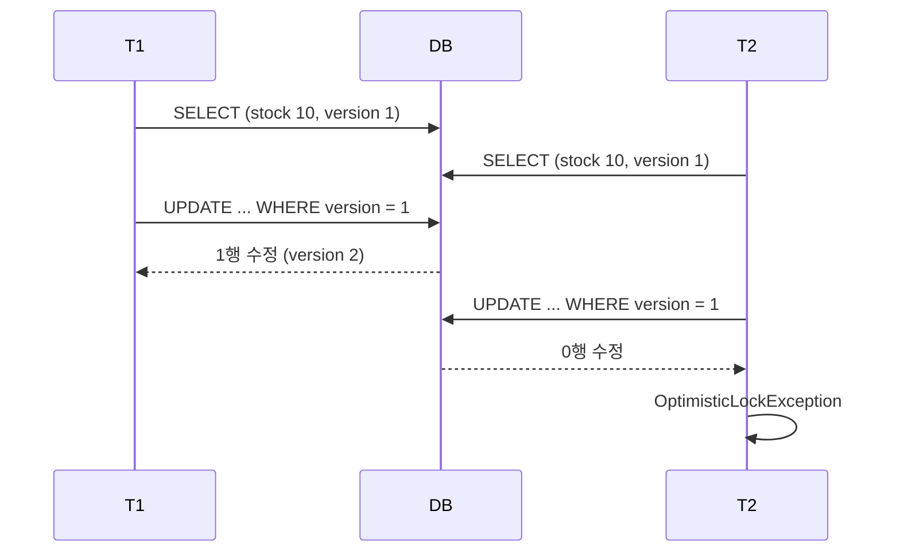

# 낙관적 / 비관적 Lock

## 문제 상황

```java
@Transactional
public void decrease(Long itemId) {
    Item item = itemRepository.findById(itemId).orElseThrow();   // stock = 10
    item.decrease(1);                                             // stock = 9
}   // 변경 감지 → UPDATE item SET stock = 9
```

요청 100개가 동시에 들어오면 여러 트랜잭션이 같은 `stock = 10`을 읽는다. 다들 9로 UPDATE해서 재고가 99개 줄어야 하는데 몇 개만 줄어든다. **Lost Update**다.

격리 수준을 올려도 MySQL REPEATABLE READ에서는 막히지 않는다. ([Isolation Level](./isolation-level.md)) 그래서 애플리케이션에서 락을 건다.

## 낙관적 락 (Optimistic Lock)

**충돌이 거의 없을 거라고 보고**, 락을 걸지 않고 진행하다가 커밋할 때 충돌을 확인한다.

```java
@Entity
public class Item {
    @Id
    private Long id;

    private int stock;

    @Version
    private Long version;
}
```

```sql
UPDATE item SET stock = 9, version = 2 WHERE id = 1 AND version = 1;
```

- 엔티티를 수정하면 JPA가 UPDATE에 `version` 조건을 붙이고 버전을 1 올린다.
- 그 사이 다른 트랜잭션이 먼저 수정했다면 version이 이미 2라서 **수정된 행이 0개**다.
- JPA는 이걸 충돌로 보고 `OptimisticLockException`을 던진다. Spring에서는 `ObjectOptimisticLockingFailureException`으로 바뀐다.



**특징**

- DB 락을 오래 잡지 않아서 충돌이 적을 때 성능이 좋다.
- 충돌하면 **애플리케이션이 직접 처리**해야 한다. 재시도하거나 사용자에게 다시 시도하라고 알린다.
- 충돌이 잦으면 재시도가 쌓여서 오히려 느려진다.
- DB 트랜잭션 하나를 넘어서는 충돌도 막을 수 있다. 사용자가 수정 화면을 열어두는 동안 다른 사람이 먼저 저장한 경우처럼, 화면에 version을 담아뒀다가 저장할 때 비교한다.

```java
// 재시도 예시 (spring-retry)
@Retryable(retryFor = ObjectOptimisticLockingFailureException.class, maxAttempts = 3)
@Transactional
public void decrease(Long itemId) { ... }
```

재시도는 트랜잭션 **밖에서** 해야 한다. 실패한 트랜잭션은 롤백된 상태라 새 트랜잭션으로 다시 읽어야 한다. 위처럼 쓰면 `@Retryable` 프록시가 `@Transactional` 프록시 바깥에 있어야 한다.

### LockModeType

| 모드 | 동작 |
| --- | --- |
| 없음 (`@Version`만) | 엔티티를 수정할 때만 버전 확인 |
| `OPTIMISTIC` | 조회만 해도 커밋 시점에 버전을 다시 확인 |
| `OPTIMISTIC_FORCE_INCREMENT` | 수정하지 않아도 버전을 올림. 연관 엔티티가 바뀌었을 때 루트 엔티티 버전을 올리는 용도 |

## 비관적 락 (Pessimistic Lock)

**충돌이 날 거라고 보고**, 읽을 때부터 DB 락을 건다.

```java
public interface ItemRepository extends JpaRepository<Item, Long> {
    @Lock(LockModeType.PESSIMISTIC_WRITE)
    @Query("select i from Item i where i.id = :id")
    Optional<Item> findByIdForUpdate(@Param("id") Long id);
}
```

```sql
SELECT * FROM item WHERE id = 1 FOR UPDATE;
```

- 먼저 락을 잡은 트랜잭션이 끝날 때까지 다른 트랜잭션은 SELECT에서 기다린다.
- 순서대로 처리돼서 Lost Update가 생기지 않는다.

| 모드 | SQL (MySQL) | 의미 |
| --- | --- | --- |
| `PESSIMISTIC_READ` | `FOR SHARE` | 공유 락. 다른 트랜잭션도 읽기 락은 걸 수 있다 |
| `PESSIMISTIC_WRITE` | `FOR UPDATE` | 배타 락. 일반적으로 쓰는 모드 |
| `PESSIMISTIC_FORCE_INCREMENT` | `FOR UPDATE` + 버전 증가 | `@Version`과 같이 쓴다 |

**특징**

- 충돌이 잦을 때 재시도 없이 정합성을 지킨다.
- 락을 기다리는 동안 커넥션을 잡고 있어서 처리량이 떨어진다.
- 락 순서가 엇갈리면 **교착 상태**가 생길 수 있다. ([Lock / Deadlock](./lock-deadlock.md))
- 락 대기 시간을 정해두는 게 좋다.

```java
@QueryHints({@QueryHint(name = "jakarta.persistence.lock.timeout", value = "3000")})
```

DB마다 지원 범위가 다르다. MySQL은 쿼리 단위 대기 시간을 지원하지 않아서 이 힌트가 무시된다. `innodb_lock_wait_timeout`을 쓰거나 `NOWAIT`, `SKIP LOCKED`를 쓴다.

## 비교

| | 낙관적 락 | 비관적 락 |
| --- | --- | --- |
| 가정 | 충돌이 드물다 | 충돌이 잦다 |
| 구현 | 버전 컬럼 (`@Version`) | DB 락 (`FOR UPDATE`) |
| 충돌 확인 시점 | 커밋(UPDATE) 시 | 조회 시 |
| 충돌하면 | 예외, 재시도 필요 | 대기 |
| 교착 상태 | 없음 | 가능 |
| 적합한 곳 | 게시글 수정, 설정 변경 | 재고 차감, 좌석 예약, 포인트 차감 |

## 다른 방법

### 원자적 UPDATE

```java
@Modifying
@Query("update Item i set i.stock = i.stock - :qty where i.id = :id and i.stock >= :qty")
int decrease(@Param("id") Long id, @Param("qty") int qty);
```

- 읽고 계산하지 않고 DB가 한 문장 안에서 계산한다. UPDATE는 배타 락을 걸고 최신 값 기준으로 실행되니 Lost Update가 없다.
- 반환값이 0이면 재고가 부족한 것이다.
- 단순한 증감이면 가장 간단하고 빠르다. 대신 영속성 컨텍스트를 거치지 않는다.

### 분산 락

서버가 여러 대이거나 DB 하나로 묶을 수 없는 자원이면 Redis(Redisson), ZooKeeper 같은 외부 저장소로 락을 건다.

- 락 획득과 해제를 트랜잭션 **바깥에서** 해야 한다. 트랜잭션 안에서 락을 풀면 커밋 전에 다음 요청이 들어와서 커밋되지 않은 값을 기준으로 처리할 수 있다.
- `synchronized`는 JVM 하나 안에서만 동작해서 서버가 여러 대면 소용이 없다. 게다가 `@Transactional` 메서드에 붙이면 프록시의 커밋이 `synchronized` 블록 밖에서 일어나서 단일 서버에서도 막지 못한다.
