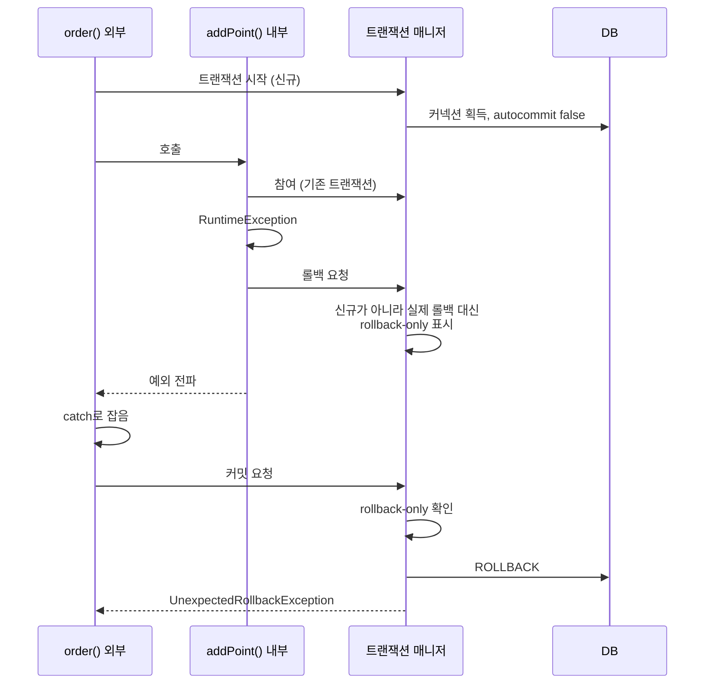

# Transaction Propagation

## 트랜잭션 전파란

트랜잭션이 이미 진행 중일 때 **또 다른 `@Transactional` 메서드를 호출하면 어떻게 할지** 정하는 규칙이다.

```java
@Service
public class OrderService {
    @Transactional
    public void order() {
        orderRepository.save(order);
        pointService.addPoint();   // 여기도 @Transactional
    }
}
```

`addPoint()`는 `order()`의 트랜잭션에 참여할 수도 있고, 새 트랜잭션을 따로 열 수도 있다.

## 물리 트랜잭션과 논리 트랜잭션

Spring은 트랜잭션을 두 단계로 나눠서 본다.

- **물리 트랜잭션**: 실제 DB 커넥션에서 시작하고 커밋하는 트랜잭션
- **논리 트랜잭션**: `@Transactional` 메서드 하나하나가 여는 트랜잭션

`REQUIRED`(기본값)로 두 메서드가 같은 트랜잭션에 참여하면 논리 트랜잭션은 두 개, 물리 트랜잭션은 하나다.

```text
┌─────────────── 물리 트랜잭션 ───────────────┐
│ ┌─ 논리 (외부: order) ─────────────────────┐ │
│ │      ┌─ 논리 (내부: addPoint) ─┐         │ │
│ │      └────────────────────────┘         │ │
│ └─────────────────────────────────────────┘ │
└─────────────────────────────────────────────┘
```

원칙은 두 가지다.

- **모든 논리 트랜잭션이 커밋돼야 물리 트랜잭션이 커밋된다.**
- **논리 트랜잭션 하나라도 롤백되면 물리 트랜잭션은 롤백된다.**

실제 커밋과 롤백은 **처음 트랜잭션을 시작한 외부 트랜잭션**만 한다. 내부 트랜잭션이 커밋해도 DB에는 아무 일도 없다.

## 전파 옵션

| 옵션 | 기존 트랜잭션 있음 | 기존 트랜잭션 없음 |
| --- | --- | --- |
| `REQUIRED` (기본) | 참여 | 새로 시작 |
| `REQUIRES_NEW` | 기존 것을 잠시 멈추고 새로 시작 | 새로 시작 |
| `SUPPORTS` | 참여 | 트랜잭션 없이 실행 |
| `NOT_SUPPORTED` | 기존 것을 멈추고 트랜잭션 없이 실행 | 트랜잭션 없이 실행 |
| `MANDATORY` | 참여 | 예외 (`IllegalTransactionStateException`) |
| `NEVER` | 예외 | 트랜잭션 없이 실행 |
| `NESTED` | 중첩 트랜잭션 (savepoint) | 새로 시작 |

실무에서는 대부분 `REQUIRED`와 `REQUIRES_NEW`만 쓴다.

## REQUIRED에서 내부가 롤백되면

```java
@Transactional
public void order() {
    orderRepository.save(order);
    try {
        pointService.addPoint();   // REQUIRED, 안에서 RuntimeException
    } catch (RuntimeException e) {
        log.warn("포인트 적립 실패", e);   // 예외를 잡았으니 주문은 커밋될까?
    }
}
```

**주문도 커밋되지 않는다.** 커밋 시점에 `UnexpectedRollbackException`이 난다.



- 내부 트랜잭션은 실제 롤백을 할 수 없다. 대신 트랜잭션 동기화 저장소에 **rollback-only** 표시를 남긴다.
- 외부 트랜잭션이 커밋하려고 보니 rollback-only가 표시돼 있어서 롤백한다.
- 개발자는 커밋을 기대했는데 롤백됐으니 이를 알리려고 `UnexpectedRollbackException`을 던진다.

## REQUIRES_NEW

```java
@Service
public class PointService {
    @Transactional(propagation = Propagation.REQUIRES_NEW)
    public void addPoint() { ... }
}
```

- 외부 트랜잭션과 **다른 DB 커넥션**으로 완전히 별개의 물리 트랜잭션을 연다.
- 내부가 롤백돼도 외부는 영향을 받지 않는다. (예외를 외부에서 잡는다면)
- 외부가 롤백돼도 이미 커밋된 내부는 남는다.

**쓰는 곳**

- 실패 로그, 감사 로그 저장: 본 작업이 롤백돼도 로그는 남아야 할 때
- 본 작업과 성공 여부를 분리하고 싶은 부가 작업

**주의할 점**

- 요청 하나가 **커넥션을 두 개** 쓴다. 트래픽이 많으면 커넥션 풀이 바닥나고, 모든 스레드가 두 번째 커넥션을 기다리면서 멈출 수 있다.
- 같은 클래스 안에서 호출하면 프록시를 거치지 않아서 전파 옵션이 적용되지 않는다. (9주차 내부 호출 문제) 별도 빈으로 분리한다.
- 외부와 내부가 같은 행을 수정하면 내부 트랜잭션이 외부가 잡은 락을 기다리게 된다. 외부는 내부가 끝나길 기다리므로 교착 상태가 된다.

## NESTED

- 외부 트랜잭션 안에 **savepoint**를 만든다.
- 내부가 롤백되면 savepoint까지만 되돌린다. 외부가 롤백되면 내부도 같이 롤백된다.
- JDBC savepoint를 쓰는 `DataSourceTransactionManager`에서는 동작한다. JPA(`JpaTransactionManager` + Hibernate)에서는 지원하지 않아서 거의 쓰지 않는다.

## 그 밖의 `@Transactional` 옵션

```java
@Transactional(
    propagation = Propagation.REQUIRED,
    isolation = Isolation.DEFAULT,
    readOnly = false,
    timeout = 5,                                // 초
    rollbackFor = Exception.class,
    noRollbackFor = BusinessException.class
)
```

- `readOnly`와 `isolation`은 **새 트랜잭션을 시작할 때만** 적용된다. 기존 트랜잭션에 참여하면 외부 설정을 따른다.
- `readOnly = true`면 JPA는 flush를 하지 않고, 드라이버나 DB에 따라 읽기 전용 커넥션으로 처리한다. 읽기/쓰기 DB를 나눈 구조에서는 이 값으로 Replica로 보내기도 한다.
